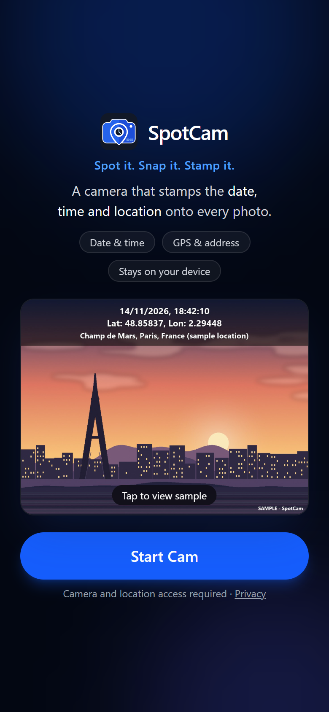
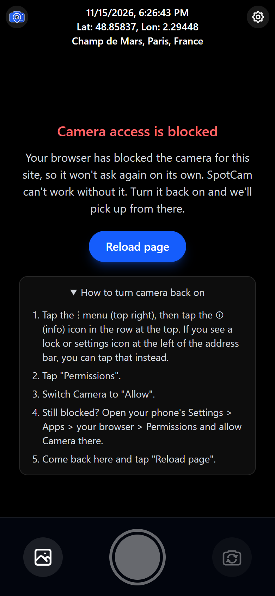
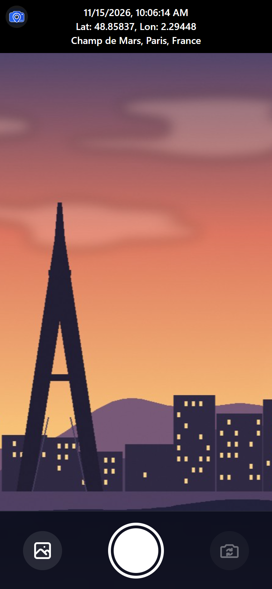
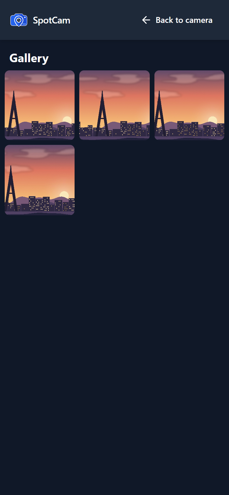
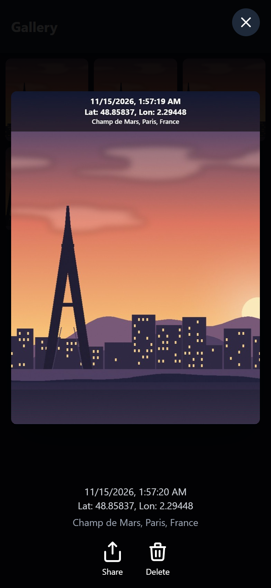

# SpotCam: user guide

> Looking for how the code works? See [docs/ARCHITECTURE.md](docs/ARCHITECTURE.md). For setup and deployment, see the [README](README.md).

## 1. What is SpotCam?

SpotCam is a web camera that stamps the **date, time and location** onto every photo you take, so each picture shows when and where it was taken. It runs in your browser on phones and computers. There is nothing to install and no account.

It is built for privacy: your photos stay in your browser. Nothing is uploaded.

Open it at **https://spotcam.in**.

---

## 2. Features

- **Live camera** straight in the browser.
- **Date, time and place on every photo**: current date and time, GPS coordinates and the street address, shown live and burned into the saved image on a dark band so it stays readable.
- **Local gallery** that keeps your photos until you delete them (or the time you choose in Settings), and shows how much space they use.
- **Share** photos through your device's share sheet, or **delete** them.
- **Helpful permission messages**: if camera or location is blocked, SpotCam says why it needs it and shows how to turn it back on for your browser.
- **Direct links**: bookmark `/cam` to open the camera straight away.
- **Private by design**: photos and data stay in your browser (IndexedDB).

---

## 3. User guide

### 3.1. The landing page

The first page explains what SpotCam is and shows a **sample photo**. Tap the sample to see what your photos will look like (with its date, time and location). You can share the sample to try the share sheet. Tap **Start Cam** to begin.

> **Tip:** you don't have to see this page every time. Go to **spotcam.in/cam** (or bookmark it) to open the camera directly.

### 3.2. Allowing camera and location

The first time, your browser asks for permission to use your **camera** and **location**. Please allow both. SpotCam can't take stamped photos without them, so the shutter stays disabled until both work.

If you blocked one, SpotCam shows a notice with what to do:

- Browsers don't show a blocked prompt again by themselves, so follow the steps for your browser (they're written for iPhone Safari, Android, Firefox, Chrome, Edge and Safari on Mac).
- Then tap **Reload page** (or **Allow access** if the prompt can still appear). If you change the setting while the page is open, SpotCam usually notices by itself.

### 3.3. The camera

1. **Live preview**: the main area shows your camera.
2. **Stamp**: the top band shows the current date and time, your GPS coordinates and your address. The address shows "Locating..." until your position is found. The small SpotCam badge at its left takes you back to the landing page.
3. **Shutter**: the large round button in the middle takes the photo.
4. **Gallery**: the button on the left opens your photos.
5. **Switch camera**: the button on the right flips between front and back cameras (if your device has both).
6. **Zoom**: if your camera supports it, a zoom slider appears above the controls.
7. **Photo / Video**: the switch above the shutter chooses what the shutter does. In **Video** mode, tap the round button to start recording and tap it again to stop. The date, time and place are drawn on every frame of the video, the running time is shown, and the video stops by itself at the longest length chosen in Settings (5 minutes by default). Sound is recorded too: your browser asks for the microphone the first time, and if you refuse, the video is recorded without sound. Videos are saved in the format your browser records (MP4 or WebM), and the gallery keeps them next to your photos.

### 3.4. The gallery

Your photos appear in a grid, newest first. The camera icon at the top returns to the camera. With no photos yet, you'll see a message pointing you back to the camera.

### 3.5. A single photo

Tap a photo to open it.

- You see the full photo with its stamp, and the date, coordinates and address below it.
- **Share** opens your device's share sheet.
- **Delete** asks you to confirm, then removes the photo for good.
- **X** or your phone's **Back** gesture closes the photo and returns to the gallery.

---

## 4. Good to know

- Photos are saved **only in your browser**. Clearing site data or switching browsers removes them. Share or save photos you want to keep.
- The gallery keeps your photos and videos until you delete them. It shows the space they use, for photos and videos separately, and has a filter to show everything, only photos, or only videos. Videos take much more space than photos.
- **Settings > Video** has three choices, all on by default except the length: record video at all, record sound, and the longest video (1, 2, 5, 10 or 15 minutes; 5 by default).
- If your browser cannot record the camera, SpotCam only offers photos.
- The address comes from free public services based on [OpenStreetMap](https://www.openstreetmap.org/) data: Photon first, then BigDataCloud, then OpenStreetMap Nominatim if the others are unavailable. Your coordinates are sent only to the one that answers, only to look up the address. Photos are never sent anywhere.
- SpotCam looks up the address only after you have moved a short way, not on every GPS update. If no service answers, the screen says "Address unavailable" with a Retry button, and a photo is stamped with the coordinates only (never with an error message).
- SpotCam needs a modern browser (recent Chrome, Edge, Firefox or Safari) and a secure (HTTPS) connection for the camera and location.

---

## 5. Privacy

The full policy is at **https://spotcam.in/privacy** (also linked under the Start Cam button on the landing page).

## 6. Technical overview

SpotCam is a single-page React app that uses standard web APIs: `getUserMedia` (camera), the Geolocation API with `watchPosition` (location), an HTML `<canvas>` (drawing the stamp), IndexedDB (storage) and the Web Share API (sharing). The full explanation of how it fits together is in [docs/ARCHITECTURE.md](docs/ARCHITECTURE.md).
