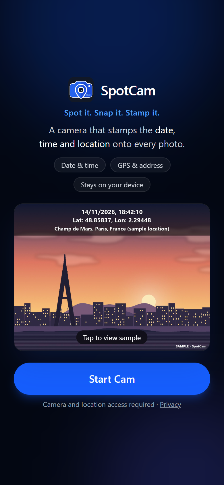
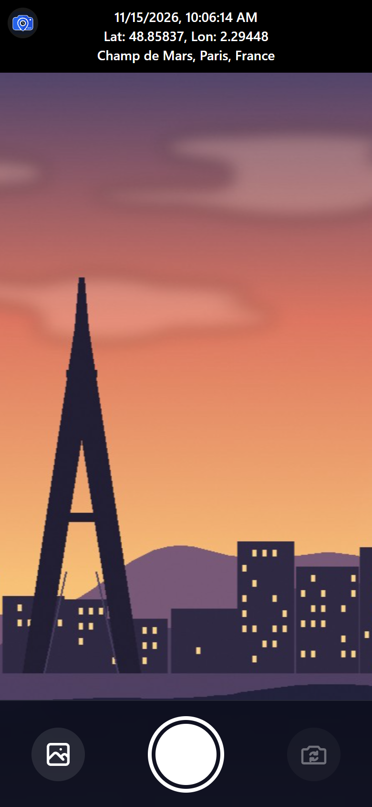
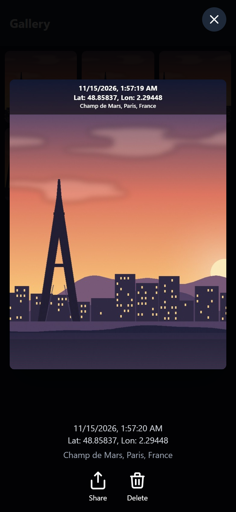
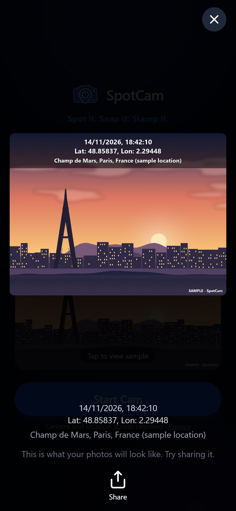
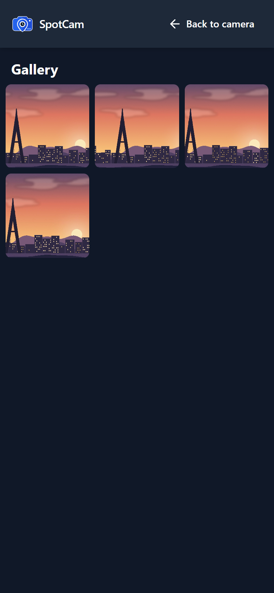
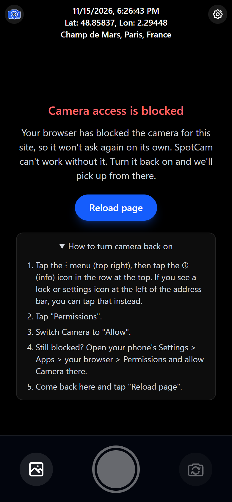
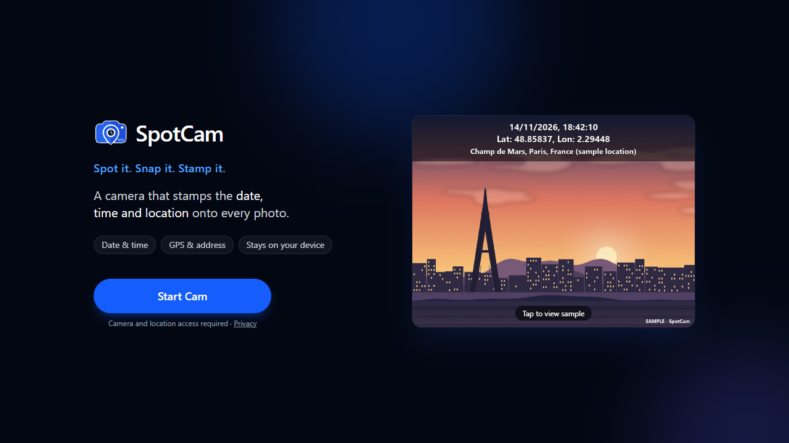

# SpotCam

**Spot it. Snap it. Stamp it.**

SpotCam is a web camera that stamps the date, time and location onto every photo you take. It runs entirely in your browser. There is no account and no server, and your photos never leave your device.

**Live:** https://spotcam.in

<p align="center">
  
  
  
</p>

## Features

- Live camera with a readable date, time, GPS and address stamp, burned into the saved photo
- Gallery of your latest photos, kept on your device (IndexedDB)
- Share through the phone's native share sheet
- Clear help when camera or location access is blocked, with steps for your browser
- Works on phones and desktops; installable to the home screen
- Direct, bookmarkable links, so the camera opens in one tap

## Screenshots

| Landing | Sample photo | Camera |
| --- | --- | --- |
|  |  |  |

| Gallery | Photo | Permission blocked |
| --- | --- | --- |
|  |  |  |

On desktop:



The screenshots come from the real built site and can be regenerated with `npm run screenshots`.

## Pages

| URL | Page |
| --- | --- |
| `/` or `/home` | Landing page with a sample photo |
| `/cam` | Camera. Asks for camera and location if they haven't been granted yet |
| `/gallery` | Gallery |
| `/privacy` | Privacy policy |

GitHub Pages is static hosting, so the build emits a real `index.html` for each route plus a `404.html` that falls back to the landing page (see `spaRoutes` in `vite.config.ts`).

## Tech

Vite, React 19, TypeScript, Tailwind CSS v4, [`idb-keyval`](https://github.com/jakearchibald/idb-keyval) for storage, Playwright for tests. Addresses come from free public geocoders built on OpenStreetMap data ([Photon](https://photon.komoot.io/), with BigDataCloud and [Nominatim](https://nominatim.org/) as fallbacks).

## Run locally

Prerequisites: Node.js 22+

```
npm install
npm run dev
```

The dev server uses HTTPS with a self-signed certificate, so you can open it on a phone on the same Wi-Fi (browsers only allow the camera and location on HTTPS). Open the **Network** URL that Vite prints, and accept the certificate warning once.

## Test

```
npm run typecheck   # TypeScript
npm run test:unit   # fast unit tests (Vitest, tests/unit/)
npm run test:e2e    # browser tests (Playwright, e2e/)
npm run test:live   # optional: one real request to each address service (see below)
```

The same checks run in GitHub Actions on every pull request, and a release to Pages only goes ahead if they all pass.

End-to-end tests run against the production build, served by a small server that behaves like GitHub Pages (no single-page-app fallback). They cover routing, the landing page layout, camera and location permissions, the browser-specific recovery steps, the Back gesture, and the gallery on small screens.

```
npx playwright install chromium firefox webkit   # once
npm run test:e2e
```

- Tests run in Chromium (Android profile), Firefox and WebKit (iPhone profile). Camera and permission outcomes are mocked in the page, so they behave the same in every engine; real Chromium permission prompts have their own tests.
- Run one browser: `npm run test:e2e -- --project=firefox`
- On Windows you can reuse the installed Edge for Chromium: `PW_CHANNEL=msedge npm run test:e2e`
- Some tests need a fake camera stream and skip themselves in browser builds that can't make one (Playwright's WebKit on Windows). Run the full set on Linux or macOS, or in CI.
- Tests never contact the real address services, so running them can't get your IP address rate limited: unit tests use a fake `fetch`, and the Playwright tests block those hosts and answer from mocks. `npm run test:live` is the one exception. It sends a single request to each service (for the Eiffel Tower, not your location) to check they still answer in the shape the code expects. Run it rarely, by hand. It is not part of `npm test` or CI.
- Regenerate the README screenshots: `npm run screenshots`

## Deploy

Pushes to `main` build and deploy to GitHub Pages through `.github/workflows/deploy.yml`.

One-time setup: repo **Settings > Pages > Source: GitHub Actions**. GitHub Pages on a private repo needs a paid GitHub plan; otherwise make the repo public.

The site is served from the root of its domain, so the build uses `base: '/'`. To build for a plain project site (`https://<user>.github.io/Spot-Cam/`), set `BASE_PATH=/Spot-Cam/`.

## Project layout

```
components/   Landing, camera, gallery and permission-notice views
hooks/        Routing, geolocation, permissions, history layers, storage
utils/        Shared helpers and browser-specific permission help
public/       Icons, manifest and the sample photo
tests/unit/   Vitest unit tests
e2e/          Playwright tests and the Pages-like test server
docs/         Architecture guide and README screenshots
```

## Docs

- [DOCUMENTATION.md](DOCUMENTATION.md): user guide, how to use SpotCam
- [Privacy policy](https://spotcam.in/privacy): what SpotCam does with your data (source: `components/PrivacyView.tsx`)
- [docs/ARCHITECTURE.md](docs/ARCHITECTURE.md): how the code works and where things live

## License

[MIT](LICENSE) © 2026 Swaroop
