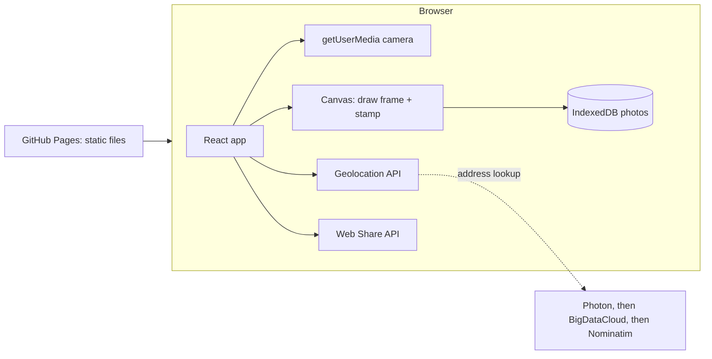
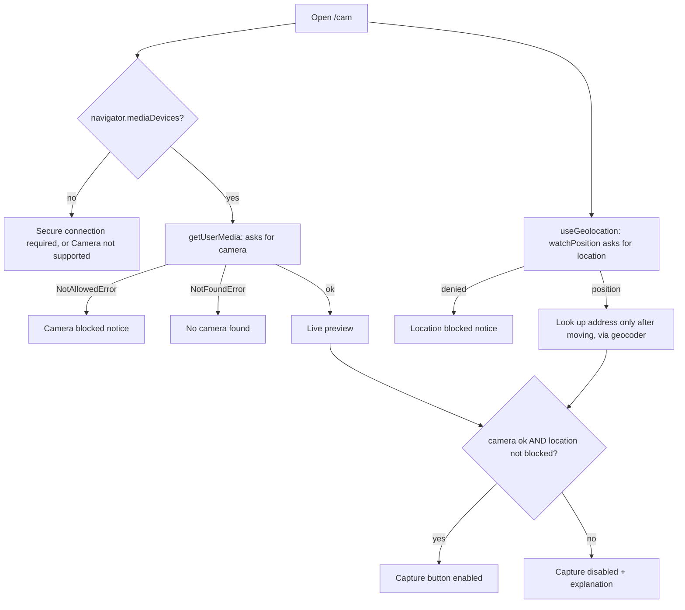

# SpotCam architecture

A guide to how SpotCam works and where things live, for anyone reading or changing the code. For using the app, see [DOCUMENTATION.md](../DOCUMENTATION.md). For setup, scripts and deployment, see the [README](../README.md).

## 1. The big picture

SpotCam is a **static, client-side single-page app**. There is no backend, no database and no API of our own.



- **Hosting:** GitHub Pages serves static files at https://spotcam.in. It scales with the CDN, and our cost doesn't grow with traffic.
- **Privacy:** photos never leave the browser. The only network calls are for the app's own files and address lookups (coordinates sent to the geocoding service that answers: Photon, BigDataCloud or Nominatim).
- **Stack:** Vite, React 19, TypeScript, Tailwind CSS v4, `idb-keyval`, Playwright.

## 2. Folder map

```
index.html              Entry page: icons, manifest, meta, share-preview tags
index.tsx               Mounts <App/>, imports index.css
index.css               Tailwind import + viewport-height helper (.app-h)
App.tsx                 Chooses the view from the URL; owns the photo list
types.ts                CapturedPhoto, GeolocationData

components/
  LandingView.tsx       First screen: tagline, sample photo viewer, Start Cam
  CameraView.tsx        Live camera, stamp overlay, capture, permission handling
  GalleryView.tsx       Photo grid, photo viewer, delete confirmation
  PermissionNotice.tsx  "We need this permission" message + browser-specific steps
  PrivacyView.tsx       The privacy policy page (keep it true to what the code does)
  SettingsView.tsx      Settings, including the language
  icons.tsx             Inline SVG icons

hooks/
  usePathRoute.ts       Tiny History-API router (/, /home, /cam, /gallery)
  useHistoryOverlay.ts  Ties full-screen layers to browser history (Back closes them)
  useViewportHeight.ts  Keeps --app-height = the visible viewport height
  useGeolocation.ts     watchPosition + reverse geocoding + denied detection
  usePermissionState.ts Permissions API wrapper ('granted' | 'prompt' | 'denied' | 'unknown')
  usePersistedPhotos.ts IndexedDB-backed photo list (with migration from localStorage)

utils/
  helpers.ts            formatDateTime, dataURLtoFile
  permissionHelp.ts     Detects the browser and returns "how to enable it" steps (worded in the chosen language, from the catalogs)
  constants.ts          FONT_FAMILY_OVERLAY (stamp font), page titles and tagline (from the English messages)
  i18n.ts               Languages: detection, the chosen language, message lookup, plural forms

locales/
  en.ts                 Every message in English, and the list of keys the other languages must have
  <code>.ts              One file per other language (hi, es, fr, ar, ...), loaded only when it is the language in use

public/                 Copied as-is to the site root: icons, manifest, sample.jpg
e2e/                    Playwright tests + a Pages-like static server
docs/                   README screenshots and this file
.github/workflows/      deploy.yml (build + deploy to Pages)
vite.config.ts          Plugins, base path, per-route page generation
```

## 3. Routing

`hooks/usePathRoute.ts` maps the URL path to a view using the History API:

| Path | View |
| --- | --- |
| `/` or `/home` (and any unknown path) | Landing |
| `/cam` | Camera |
| `/gallery` | Gallery |
| `/privacy` | Privacy policy (a scrollable document page) |
| `/how-it-works` | What SpotCam does, use cases and a short FAQ (text in `content/howItWorks.ts`) |

`App.tsx` renders exactly one view. Navigation calls `history.pushState`, so the browser's Back and Forward work.

**Why real pages per route:** GitHub Pages is static hosting and cannot rewrite `/cam` to the app. The `spaRoutes` plugin in `vite.config.ts` writes a real `index.html` for `home`, `cam`, `gallery`, `privacy`, `settings` and `how-it-works`, plus `dist/404.html` (unknown paths show the landing page). A direct visit or refresh of `/cam` therefore works.

**Per-page head and static content (SEO):** `utils/seo.ts` holds each page's title, description, canonical address, indexing choice and a short block of static HTML. At build time `spaRoutes` fills the `<!--seo:start-->` markers in `index.html` with that page's tags (canonical, Open Graph, `robots`, JSON-LD) and puts the static HTML inside `<div id="root">`, so crawlers and link previews get distinct content without running JavaScript. React replaces the static block when it starts. The landing page's heading carries the words people search for (the name, then "a free timestamp camera for photos and video, with the date, time and GPS location"), and its static block holds real text and a link to the how-it-works page for crawlers that run no JavaScript. The page titles are shared with the app (`PAGE_TITLES`), so the title does not change when React starts. The content pages also carry a `BreadcrumbList`, and the landing page `WebApplication` and `WebSite` data. `/` and `/how-it-works/` and `/privacy/` are indexable; the camera, gallery, settings and the 404 page are `noindex`. `/home` names `/` as its canonical.

**Sitemap, robots.txt and the site address:** the repository names no domain. The build reads `SITE_URL` (the deploy workflow sets it; the e2e tests use a placeholder). With it, the `seoFiles` plugin writes `dist/sitemap.xml` and a `robots.txt` that names it, and the pages get absolute canonical and `og:image` addresses (the 1200x630 `public/social-card.png`). Without it the build still works but has no sitemap, canonical or absolute card URLs. Only the indexable pages are listed in the sitemap.

**Base path:** `base` is `/` for the custom domain. Set `BASE_PATH=/Spot-Cam/` to build for a plain `github.io/<repo>/` site. Router and asset URLs read Vite's `BASE_URL`, so both work.

## 4. Full-screen layers and the Back gesture

The sample viewer, the gallery photo viewer and the delete confirmation are **layers** that own a history entry (`hooks/useHistoryOverlay.ts`).

- `open()` pushes an entry, so the phone's Back gesture **closes the layer** and nothing else.
- `close()` (X button) calls `history.back()` to remove the entry, so no stale entry is left to reopen later.
- Layers nest: a delete confirmation over the viewer adds its own key to `history.state`. Confirming a delete closes both with one `history.go(-2)`.

Without this, Back left the page and the browser later restored it (back/forward cache) with the viewer still open. A regression test covers it (`e2e/back-navigation.spec.ts`).

## 5. Layout on phones

Phones have browser toolbars and Android's navigation bar, so `100vh` is taller than what you can see. Anything sized with it pushes bottom controls off-screen.

- `hooks/useViewportHeight.ts` sets the CSS variable `--app-height` to `window.innerHeight` on load, resize and rotation. (`innerHeight` ignores pinch-zoom, unlike `visualViewport.height`.)
- `.app-h` in `index.css` uses it, with `100dvh` as the fallback before JS runs.
- Full-screen layers are flex columns: the image takes the leftover space (`flex-1 min-h-0`), while the details and Share/Delete buttons are `shrink-0`. Controls can't be pushed out of view. Bottom padding uses `env(safe-area-inset-bottom)`.
- **Accessibility** (tracked in #2): every dialog uses `hooks/useDialogFocus.ts` (focus moves in, Tab is trapped, Esc closes, focus returns to the trigger). Gallery thumbnails are real buttons whose name carries the date and place (the stamp is drawn into the pixels, so screen readers cannot read it). The camera page announces location, address and saved photos through an `aria-live` region, has a labelled preview and plus/minus zoom buttons, and each page has its own `<title>` (`PAGE_TITLES`). `index.css` adds a visible focus ring and honours `prefers-reduced-motion`. `e2e/a11y.spec.ts` runs axe-core (WCAG 2.2 AA) on every page and state and fails on serious or critical violations; `e2e/a11y-behaviour.spec.ts` covers keyboard, focus and announcements.
- On a phone held sideways (the `short` Tailwind variant: landscape and under 500 px tall, defined in `index.css`), the camera page moves its controls into a column on the right and compacts the stamp, so most of the preview stays free. `e2e/camera-landscape.spec.ts` measures this.
- The landing page fits one screen with no scrolling on small phones (360x640), and tests guard this.

## 6. Camera, permissions and capture

`components/CameraView.tsx` is the core. Flow on load:



**Capture is only enabled when both permissions work.** The stamp is the whole point of the app. See `canCapture` in `CameraView.tsx`.

**Detecting "blocked":** two signals are combined. The Permissions API (`usePermissionState`) reports `denied`, and the real errors from `getUserMedia` (`NotAllowedError`) and geolocation (`code === PERMISSION_DENIED`) confirm it. Safari can't query the camera permission, so it relies on the errors.

**Helping the user recover:** browsers never show a blocked prompt again, and a page can't reset it. `PermissionNotice` therefore:
- Shows **Reload page** and the steps up front when the browser reports `denied` (a hard block).
- Shows **Allow access**, which re-requests the permission, when a prompt can still appear (a soft block), with the manual steps one tap away.
- `utils/permissionHelp.ts` picks steps by user agent: iOS Safari/Chrome, Android, Firefox, desktop Chrome/Edge and macOS Safari. Android leads with the ⋮ menu, because the site-info icon isn't always at the left of the address bar.
- The page also **recovers on its own** when the browser reports the permission became `granted`.

**The stamp on a captured photo** (`handleCapture`): the video frame is drawn onto a hidden `<canvas>`; a translucent dark band is drawn at the top, then bold white text (date and time, coordinates, then the wrapped address). Sizes are proportional to the image width. The font is a system stack (`FONT_FAMILY_OVERLAY`), so canvas drawing needs no font loading and works offline. The result is saved as a JPEG data URL.

## 7. Photo storage

`hooks/usePersistedPhotos.ts` keeps the gallery in **IndexedDB** via `idb-keyval`, under one key (`spotcam-photos`).

- Each photo has two entries: a small record (`spotcam-photo:<id>`: time, place, a thumbnail and the size in bytes) and the full-size photo (`spotcam-photo-full:<id>`). An index (`spotcam-photo-ids`) keeps the order, newest first. The gallery holds only the small records (`GalleryPhoto`), so it stays light however many photos there are; the full photo is read (`utils/photoStore.ts`) only when it is opened, shared or downloaded. A new photo's full data waits in memory until it is written, so it opens at once. There is no cap on the count; the gallery shows the space used and the browser's estimate of what is free, and the app shows a notice if a save fails (out of space). Saves run one after another through a queue that starts with the load.
- **Videos** use the same layout: the small record carries `kind: 'video'`, `mimeType` and `durationMs`, and the full entry holds the recording as a `Blob` (IndexedDB stores blobs natively) in whatever format the browser records. `utils/videoRecorder.ts` copies the live picture to an off-screen canvas about 30 times a second (at most 1280 px on the long side), draws the stamp on every frame with `utils/stamp.ts` (the same code the photo uses, with the clock of that moment), and records the canvas stream together with the microphone track using `MediaRecorder`. `utils/video.ts` picks the format (MP4 if the browser can record it, else WebM) and holds the pure helpers. The microphone is asked for only when recording starts and only if "Record sound" is on; a refusal records without sound. Leaving the camera page ends and saves a recording in progress. The viewer plays a video from an object URL made from the stored blob.
- Older versions stored the whole list under one key (`spotcam-photos`), and before that in `localStorage` (about 5 MB). On first load the store migrates either (and the previous per-photo layout, where the full photo sat inside the record) into the layout above, making thumbnails on the way.
- A ref mirrors the state so rapid successive updates never act on stale data, and photos taken during the initial load aren't lost.

## 8. Address lookup

`hooks/useGeolocation.ts` calls `watchPosition`. The coordinates update immediately; the address follows from `utils/geocoder.ts`, and is looked up only after the user has moved about 25 m, not on every GPS update.

The geocoder is built to be gentle on free public services, because the public Nominatim server answers HTTP 429 to clients that send too many requests, and browsers hide that status behind a CORS error. It therefore: caches by rounded coordinates, keeps one request in flight, spaces lookups at least a second apart, tries providers in order (Photon, BigDataCloud, Nominatim), and puts a failing provider on a cool-down that doubles on each failure (5 s up to 60 s, with jitter). The lookup status (`loading`, `ok`, `failed`, `offline`) is kept apart from the address text, so a message such as "Address unavailable" can never be stamped on a photo. Attribution: map data © OpenStreetMap contributors.

## 9. Sharing

`GalleryView` and the landing page's sample viewer convert the image to a `File` (`dataURLtoFile`) and call the **Web Share API**. Where file sharing isn't supported, the sample falls back to a download. The text shared with a gallery photo ends with a link to the spot it was taken (`utils/maps.ts`, `shareText`). The map service for that link (Google Maps by default, or Apple Maps or OpenStreetMap) is chosen on the Settings page and kept in `localStorage` with the other settings; the link is only text, so nothing is sent anywhere by SpotCam.

## 9a. Languages

All the words the person reads live in `locales/`: `en.ts` holds every message (and defines the key list), and each other language is a file with the same keys (`hi.ts`, `es.ts`, ... 20 languages in all, listed in `LANGUAGES`). `utils/i18n.ts` looks messages up (`translate`, `translatePlural`, the `useT()` hook) and falls back to English for a message a language lacks. English is built in; the others are separate chunks loaded only when chosen, and the service worker keeps each one the first time it is used (they are not precached, so a visitor does not download the ones they never use), so a language used online also works offline.

- **Which language is used.** The person's choice in Settings (kept in the `language` setting in `localStorage`) wins. Without one, the browser's preferred languages decide, but only when that is clear: the first one SpotCam has (`hi-IN` counts as Hindi). A list with nothing SpotCam has, or no list, means English. `index.tsx` waits for the language to load before the first draw, so the page never flashes English first, and `<html lang>` follows the language.
- **Messages.** `{name}` is filled in by the app; `<b>text</b>` is shown highlighted; a count-dependent message has one entry per plural form (`key.one`, `key.other`, plus `few` and `many` where a language needs them), chosen with `Intl.PluralRules`. Whole sentences per kind (photo, video) are used instead of gluing nouns together, because word order and endings differ by language.
- **Right to left.** Arabic and Urdu set `dir="rtl"` on `<html>` (`directionOf` in `utils/i18n.ts`). Text spacing uses logical classes (`ps-`, `me-`, ...) so it flips; the camera and gallery overlays keep their physical corners, as camera apps usually do; the English privacy policy stays `dir="ltr"`.
- **Counts.** Languages with several plural forms (Russian, Arabic) word a count so that one form reads correctly for every number ("Фото: 5"), so each file only needs `.one` and `.other`.
- **Simplified Chinese only.** `zh` is Simplified; a browser asking for Traditional (`zh-TW`, `zh-HK`, `zh-Hant`) is not a clear match and gets English until Traditional is added.
- **Adding a language.** Add its file under `locales/` (the compiler lists every missing key), add it to `LANGUAGES` and `loaders` in `utils/i18n.ts`, and add it to `e2e/messages.ts` (`CATALOGS`, `BROWSER_LOCALE`). The unit test checks every key exists, no message is empty and the `{placeholders}` match English; `e2e/language-screens.spec.ts` then checks every screen in the new language with no other edit.
- **What stays in English everywhere:** the name SpotCam, the stamp drawn on photos and videos, the privacy policy (a note in the chosen language says so), and the map services' names. The steps for turning a blocked permission back on are translated, but they quote the browser's own menu names, which depend on the browser's language, so a native speaker should check them (see the note on review in the pull request). The pre-rendered static pages (what search engines see) are English; one page per language with `hreflang` is future work (issue #3).

## 10. Branding, icons and installability

`public/` holds the favicon (`favicon.svg`), the Apple touch icon, 192/512 px icons and `manifest.webmanifest` (name, colours and a `start_url` of `./cam`). `index.html` links them and adds the canonical URL and share-preview (Open Graph) tags for `https://spotcam.in/`.

**Offline and updates (service worker).** The build writes `dist/sw.js` from `sw/sw.template.js` (the `serviceWorker` plugin in `vite.config.ts`; helpers and tests in `utils/precache.ts` and `tests/unit/precache.test.ts`). It precaches the pages, scripts, styles, icons and the sample photo, so the app opens with no connection and photos can still be taken and saved (the stamp then shows the coordinates and says the address is unavailable). Rules:

- Pages are **network first** (a deploy shows up straight away for people who are online) and fall back to the cached copy when offline or when the network takes over 3 s. Hashed scripts, styles and images are cache first.
- It only answers requests it precached. **Other sites (the address services), `version.txt`, `sitemap.xml` and `robots.txt` always go to the network**, so the deploy check and search engines see the real thing.
- The cache is named after a hash of the built files (`spotcam-<hash>`), so every release gets a fresh cache and the previous one is deleted when the new worker activates.
- **A new version waits.** `hooks/useServiceWorker.ts` registers the worker (production builds only) and checks for a new one when the tab comes back and hourly. When one is ready, `UpdateToast` offers **Reload**; only then does the worker take over and the page reload once, so nobody is switched mid-photo.
- If the site sits behind a CDN, do not cache `/sw.js` there: browsers must see a new worker quickly.

Install: the landing page shows an **Install app** button when the browser offers one (`hooks/useInstallPrompt.ts`, `beforeinstallprompt`), and "tap Share, then Add to Home Screen" on iPhone and iPad. `manifest.webmanifest` has an `id`, `any` and `maskable` icons (`icon-maskable-512.png`, artwork kept inside the safe zone) and install-dialog screenshots in `public/screenshots/` (copies of the files in `docs/screenshots/`; refresh them when the screenshots change).

Tests: `e2e/pwa.spec.ts` turns the worker on (every other spec blocks it, in `playwright.config.ts`) and checks what is cached, offline pages, an offline photo, the update flow, the install prompt and the manifest. Playwright's WebKit and Firefox do not apply route mocks to a page a worker controls, so that spec never loads an address-requesting page there, and an `afterEach` guard fails if any real address request is seen.

## 11. Build and deploy

- `npm run build` runs `vite build` and writes `dist/`. Tailwind v4 runs through its Vite plugin, and `spaRoutes` adds the per-route pages.
- `.github/workflows/deploy.yml` builds on every push to `main` and publishes `dist/` with the official Pages actions.
- The dev server (`npm run dev`) uses `@vitejs/plugin-basic-ssl`. That gives phones on the same Wi-Fi the HTTPS they need for the camera and location.

### Analytics (optional, off by default)

- `utils/analytics.ts` asks for `analytics.config.json` next to the page. The file is not in the repository: the deploy workflow writes it into `dist/` from the `ANALYTICS_ID` repository variable. No file (a 404, a fork, a local build, the tests) means nothing happens: no banner, no script, no request.
- With a file, `hooks/useAnalytics.ts` shares the visitor's choice (stored in `localStorage` as `spotcam.analytics`) between the consent banner (shown on the landing, privacy, how-it-works and settings pages, never on the camera or gallery), Settings and the privacy page.
- The Google tag is added only after "Yes", never when the browser sends Do Not Track or Global Privacy Control (that overrides an earlier "Yes"). It is set up with consent mode (analytics storage only), no Google signals and no ad personalisation, and automatic page views off.
- App code calls only `pageView()` (on every route change, path only, no query string) and `track()` with one of five fixed events: `start_cam`, `photo_captured`, `share_used`, `permission_blocked` (with `camera` or `location`) and `pwa_installed`. Anything else is dropped. Events that happen before the choice wait in memory and are sent only after an Accept.
- The config file is never precached by the service worker. The e2e fixtures block Google's hosts for every test, and `e2e/analytics.spec.ts` uses a fake tag script.

## 12. Dependencies and updates

Everything the browser runs (React, ReactDOM, `idb-keyval`) is **bundled into our own JavaScript** (about 78 KB gzipped). We deliberately don't load libraries from a public CDN:

- A CDN adds another connection (DNS + TLS) to a different origin. GitHub Pages already serves our files from a CDN.
- Browsers no longer share a CDN cache across sites (cache partitioning), so the old "it's probably cached already" benefit is gone.
- Bundling lets the build drop unused code and keeps the app working offline later.
- An unpinned CDN version can change or break the site without a pull request, and adds supply-chain risk.

To stay current, **Dependabot** (`.github/dependabot.yml`) opens weekly pull requests for npm packages and monthly ones for GitHub Actions. The Playwright suite runs against each change before it's merged. `index.html` also preconnects to Photon, the first geocoder tried and the only third-party request the page normally makes.

## 13. Testing

**Unit tests** (Vitest, `tests/unit/`) cover pure logic such as helpers and the address lookup. **CI** (`.github/workflows/ci.yml`) runs the type check, the unit tests and the Playwright suite (one job per browser engine) on every pull request. The deploy workflow calls the same file first, so a failing test blocks a release.

**After a release goes out** the deploy workflow checks the real site: it waits until `/version.txt` shows the new commit, then runs `e2e/live/smoke.spec.ts` against `https://spotcam.in` (`npm run test:live-site`): every route answers, the script and stylesheet exist, the landing, camera, gallery and privacy pages render with no JavaScript errors or failed requests. If any of that fails, the `rollback` job rebuilds and redeploys the last release that passed (found as the most recent successful run), waits for it to be served, and opens an issue. The failing commit stays on `main`, so it still needs a fix or a revert. Failed runs are never counted as "good", so repeated failures keep rolling back to the same healthy release.

Playwright end-to-end tests live in `e2e/` and run against the **production build**, served by `e2e/pages-server.mjs`, which imitates GitHub Pages (directory redirects, `404.html`, **no** single-page-app fallback). That proves the deployed site works on plain static hosting.

| File | What it covers |
| --- | --- |
| `privacy.spec.ts` | The policy page opens directly, is linked from the landing page, and matches what the app does |
| `routes.spec.ts` | Every route, Start Cam and Back, landing page fits without scrolling, sample viewer |
| `permissions.spec.ts` | Granted, blocked (soft and hard), recovery, per-browser steps. Mocked in-page, so identical in all engines |
| `chromium-native.spec.ts` | Real Chromium permission prompts (the only engine Playwright can drive natively) |
| `back-navigation.spec.ts` | The Back gesture closes layers without leaving the page |
| `gallery-viewport.spec.ts` | Share/Delete stay visible on short screens and after the viewport resizes |
| `screenshots.spec.ts` | Not a test: `npm run screenshots` regenerates `docs/screenshots/` |
| `helpers.ts` | Camera, geolocation and permission mocks, and shared setup |

**Mocks:** the camera is replaced with a canvas stream, geolocation errors are simulated, and `navigator.permissions` is kept consistent with them. Engines that can't make a stream (Playwright's WebKit on Windows) skip those tests, with the reason shown. Projects: Chromium (Pixel 7), Firefox (desktop) and WebKit (iPhone 15).

## 14. Conventions

- **Line endings:** LF everywhere (`.gitattributes`).
- **`tmp/`** is a git-ignored scratch folder.
- **Comments** explain *why* (browser quirks, permission behaviour), not what the code says.
- **Where things go:** UI in `components/`, behaviour in `hooks/`, pure helpers in `utils/`, tests in `tests/unit/` (logic) and `e2e/` (browser).

## 15. Privacy policy

The policy lives in `components/PrivacyView.tsx` and is served at `/privacy`. It describes what the code really does: the camera and location are used on-device, photos stay in IndexedDB, and **the only data that leaves the device is the coordinates sent to the geocoder that answers (Photon, then BigDataCloud, then OpenStreetMap Nominatim)** for the address lookup. **Keep it in step with the code:** if you add analytics, uploads, cookies or change the geocoder, update the page text and `PRIVACY_LAST_UPDATED`. The test in `privacy.spec.ts` checks for the key statements.

## 16. Known limits and ideas

- The first visit needs a connection (the worker installs after it). Playwright's Firefox offline mode cannot be tested with the worker, so offline pages are tested in Chromium and WebKit only.
- The address services are free public servers with no uptime guarantee and fair-use limits. For real traffic, move to a keyed provider or a small proxy (the provider list in `utils/geocoder.ts` is the one place to change).
- All text is English only (tracked in an issue); accessibility work is tracked in another.
- Real-device checks (camera, location, the share sheet) are still manual: the tests use mocks.
