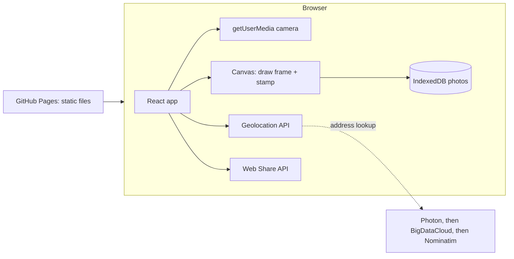
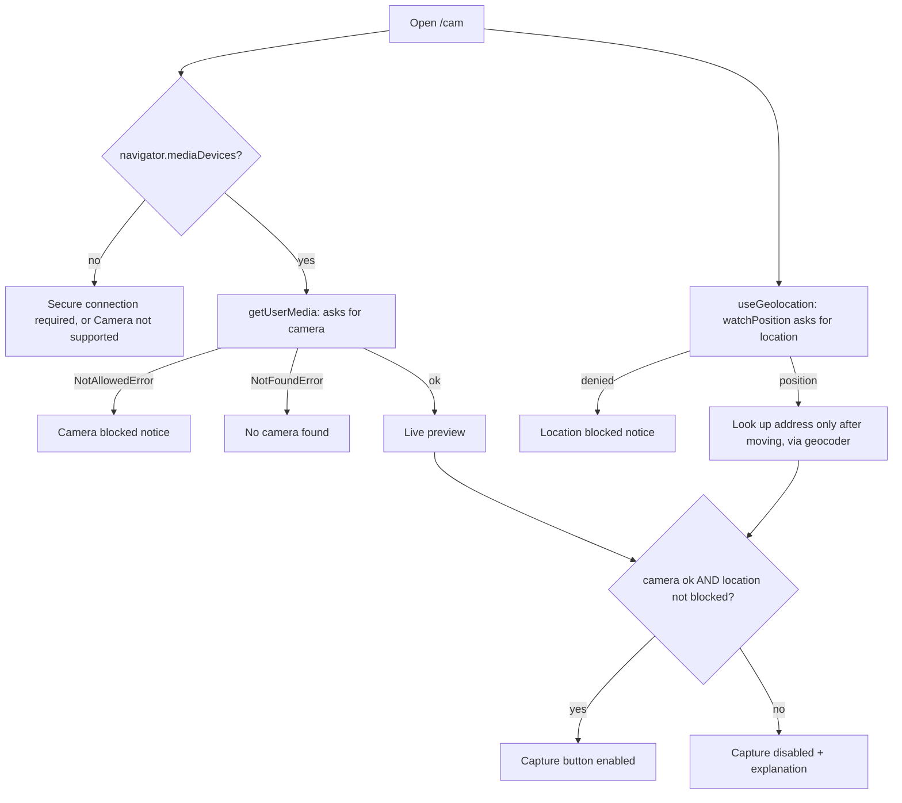

# SpotCam architecture

A guide to how SpotCam works and where things live, for anyone reading or changing the code. For using the app, see [DOCUMENTATION.md](../DOCUMENTATION.md). For setup, scripts and deployment, see the [README](../README.md).

## 1. The big picture

SpotCam is a **static, client-side single-page app**. There is no backend, no database and no API of our own.



- **Hosting:** GitHub Pages serves static files at https://spotcam.in. It scales with the CDN, and our cost doesn't grow with traffic.
- **Privacy:** photos never leave the browser. The only network calls are for the app's own files and address lookups (coordinates sent to the geocoding service that answers: Photon, BigDataCloud or Nominatim).
- **Stack:** Vite, React 19, TypeScript, Tailwind CSS v4, `idb-keyval`, Playwright.

## 2. Folder map

```
index.html              Entry page: icons, manifest, meta, share-preview tags
index.tsx               Mounts <App/>, imports index.css
index.css               Tailwind import + viewport-height helper (.app-h)
App.tsx                 Chooses the view from the URL; owns the photo list
types.ts                CapturedPhoto, GeolocationData

components/
  LandingView.tsx       First screen: tagline, sample photo viewer, Start Cam
  CameraView.tsx        Live camera, stamp overlay, capture, permission handling
  GalleryView.tsx       Photo grid, photo viewer, delete confirmation
  PermissionNotice.tsx  "We need this permission" message + browser-specific steps
  PrivacyView.tsx       The privacy policy page (keep it true to what the code does)
  icons.tsx             Inline SVG icons

hooks/
  usePathRoute.ts       Tiny History-API router (/, /home, /cam, /gallery)
  useHistoryOverlay.ts  Ties full-screen layers to browser history (Back closes them)
  useViewportHeight.ts  Keeps --app-height = the visible viewport height
  useGeolocation.ts     watchPosition + reverse geocoding + denied detection
  usePermissionState.ts Permissions API wrapper ('granted' | 'prompt' | 'denied' | 'unknown')
  usePersistedPhotos.ts IndexedDB-backed photo list (with migration from localStorage)

utils/
  helpers.ts            formatDateTime, dataURLtoFile
  permissionHelp.ts     Detects the browser and returns "how to enable it" steps
  constants.ts          FONT_FAMILY_OVERLAY (stamp font)

public/                 Copied as-is to the site root: icons, manifest, sample.jpg
e2e/                    Playwright tests + a Pages-like static server
docs/                   README screenshots and this file
.github/workflows/      deploy.yml (build + deploy to Pages)
vite.config.ts          Plugins, base path, per-route page generation
```

## 3. Routing

`hooks/usePathRoute.ts` maps the URL path to a view using the History API:

| Path | View |
| --- | --- |
| `/` or `/home` (and any unknown path) | Landing |
| `/cam` | Camera |
| `/gallery` | Gallery |
| `/privacy` | Privacy policy (a scrollable document page) |

`App.tsx` renders exactly one view. Navigation calls `history.pushState`, so the browser's Back and Forward work.

**Why real pages per route:** GitHub Pages is static hosting and cannot rewrite `/cam` to the app. The `spaRoutes` plugin in `vite.config.ts` copies the built `index.html` to `dist/home/`, `dist/cam/`, `dist/gallery/`, `dist/privacy/` and `dist/404.html` (unknown paths show the landing page). A direct visit or refresh of `/cam` therefore works.

**Sitemap and robots.txt:** the `seoFiles` plugin writes `dist/sitemap.xml` and `dist/robots.txt` at build time from `utils/sitemap.ts`. Only the pages worth indexing are listed (`/` and `/privacy/`; the camera and gallery are tools). The origin defaults to `https://spotcam.in` and can be changed with `SITE_URL` when building for another domain.

**Base path:** `base` is `/` for the custom domain. Set `BASE_PATH=/Spot-Cam/` to build for a plain `github.io/<repo>/` site. Router and asset URLs read Vite's `BASE_URL`, so both work.

## 4. Full-screen layers and the Back gesture

The sample viewer, the gallery photo viewer and the delete confirmation are **layers** that own a history entry (`hooks/useHistoryOverlay.ts`).

- `open()` pushes an entry, so the phone's Back gesture **closes the layer** and nothing else.
- `close()` (X button) calls `history.back()` to remove the entry, so no stale entry is left to reopen later.
- Layers nest: a delete confirmation over the viewer adds its own key to `history.state`. Confirming a delete closes both with one `history.go(-2)`.

Without this, Back left the page and the browser later restored it (back/forward cache) with the viewer still open. A regression test covers it (`e2e/back-navigation.spec.ts`).

## 5. Layout on phones

Phones have browser toolbars and Android's navigation bar, so `100vh` is taller than what you can see. Anything sized with it pushes bottom controls off-screen.

- `hooks/useViewportHeight.ts` sets the CSS variable `--app-height` to `window.innerHeight` on load, resize and rotation. (`innerHeight` ignores pinch-zoom, unlike `visualViewport.height`.)
- `.app-h` in `index.css` uses it, with `100dvh` as the fallback before JS runs.
- Full-screen layers are flex columns: the image takes the leftover space (`flex-1 min-h-0`), while the details and Share/Delete buttons are `shrink-0`. Controls can't be pushed out of view. Bottom padding uses `env(safe-area-inset-bottom)`.
- On a phone held sideways (the `short` Tailwind variant: landscape and under 500 px tall, defined in `index.css`), the camera page moves its controls into a column on the right and compacts the stamp, so most of the preview stays free. `e2e/camera-landscape.spec.ts` measures this.
- The landing page fits one screen with no scrolling on small phones (360x640), and tests guard this.

## 6. Camera, permissions and capture

`components/CameraView.tsx` is the core. Flow on load:



**Capture is only enabled when both permissions work.** The stamp is the whole point of the app. See `canCapture` in `CameraView.tsx`.

**Detecting "blocked":** two signals are combined. The Permissions API (`usePermissionState`) reports `denied`, and the real errors from `getUserMedia` (`NotAllowedError`) and geolocation (`code === PERMISSION_DENIED`) confirm it. Safari can't query the camera permission, so it relies on the errors.

**Helping the user recover:** browsers never show a blocked prompt again, and a page can't reset it. `PermissionNotice` therefore:
- Shows **Reload page** and the steps up front when the browser reports `denied` (a hard block).
- Shows **Allow access**, which re-requests the permission, when a prompt can still appear (a soft block), with the manual steps one tap away.
- `utils/permissionHelp.ts` picks steps by user agent: iOS Safari/Chrome, Android, Firefox, desktop Chrome/Edge and macOS Safari. Android leads with the ⋮ menu, because the site-info icon isn't always at the left of the address bar.
- The page also **recovers on its own** when the browser reports the permission became `granted`.

**The stamp on a captured photo** (`handleCapture`): the video frame is drawn onto a hidden `<canvas>`; a translucent dark band is drawn at the top, then bold white text (date and time, coordinates, then the wrapped address). Sizes are proportional to the image width. The font is a system stack (`FONT_FAMILY_OVERLAY`), so canvas drawing needs no font loading and works offline. The result is saved as a JPEG data URL.

## 7. Photo storage

`hooks/usePersistedPhotos.ts` keeps the gallery in **IndexedDB** via `idb-keyval`, under one key (`spotcam-photos`).

- The list is capped at 12 photos, newest first. New photos are prepended and the oldest are dropped.
- Older versions stored photos in `localStorage` (about 5 MB, which filled up quickly). On first load the hook migrates that data and removes the old key.
- A ref mirrors the state so rapid successive updates never act on stale data, and photos taken during the initial load aren't lost.

## 8. Address lookup

`hooks/useGeolocation.ts` calls `watchPosition`. The coordinates update immediately; the address follows from `utils/geocoder.ts`, and is looked up only after the user has moved about 25 m, not on every GPS update.

The geocoder is built to be gentle on free public services, because the public Nominatim server answers HTTP 429 to clients that send too many requests, and browsers hide that status behind a CORS error. It therefore: caches by rounded coordinates, keeps one request in flight, spaces lookups at least a second apart, tries providers in order (Photon, BigDataCloud, Nominatim), and puts a failing provider on a cool-down that doubles on each failure (5 s up to 60 s, with jitter). The lookup status (`loading`, `ok`, `failed`, `offline`) is kept apart from the address text, so a message such as "Address unavailable" can never be stamped on a photo. Attribution: map data © OpenStreetMap contributors.

## 9. Sharing

`GalleryView` and the landing page's sample viewer convert the image to a `File` (`dataURLtoFile`) and call the **Web Share API**. Where file sharing isn't supported, the sample falls back to a download.

## 10. Branding, icons and installability

`public/` holds the favicon (`favicon.svg`), the Apple touch icon, 192/512 px icons and `manifest.webmanifest` (name, colours and a `start_url` of `./cam`). `index.html` links them and adds the canonical URL and share-preview (Open Graph) tags for `https://spotcam.in/`.

There is **no service worker yet**, so the app isn't a full offline PWA. See the open items in the pull request and issues.

## 11. Build and deploy

- `npm run build` runs `vite build` and writes `dist/`. Tailwind v4 runs through its Vite plugin, and `spaRoutes` adds the per-route pages.
- `.github/workflows/deploy.yml` builds on every push to `main` and publishes `dist/` with the official Pages actions.
- The dev server (`npm run dev`) uses `@vitejs/plugin-basic-ssl`. That gives phones on the same Wi-Fi the HTTPS they need for the camera and location.

## 12. Dependencies and updates

Everything the browser runs (React, ReactDOM, `idb-keyval`) is **bundled into our own JavaScript** (about 78 KB gzipped). We deliberately don't load libraries from a public CDN:

- A CDN adds another connection (DNS + TLS) to a different origin. GitHub Pages already serves our files from a CDN.
- Browsers no longer share a CDN cache across sites (cache partitioning), so the old "it's probably cached already" benefit is gone.
- Bundling lets the build drop unused code and keeps the app working offline later.
- An unpinned CDN version can change or break the site without a pull request, and adds supply-chain risk.

To stay current, **Dependabot** (`.github/dependabot.yml`) opens weekly pull requests for npm packages and monthly ones for GitHub Actions. The Playwright suite runs against each change before it's merged. `index.html` also preconnects to Nominatim, the one third-party request the page makes.

## 13. Testing

**Unit tests** (Vitest, `tests/unit/`) cover pure logic such as helpers and the address lookup. **CI** (`.github/workflows/ci.yml`) runs the type check, the unit tests and the Playwright suite (one job per browser engine) on every pull request. The deploy workflow calls the same file first, so a failing test blocks a release.

**After a release goes out** the deploy workflow checks the real site: it waits until `/version.txt` shows the new commit, then runs `e2e/live/smoke.spec.ts` against `https://spotcam.in` (`npm run test:live-site`): every route answers, the script and stylesheet exist, the landing, camera, gallery and privacy pages render with no JavaScript errors or failed requests. If any of that fails, the `rollback` job rebuilds and redeploys the last release that passed (found as the most recent successful run), waits for it to be served, and opens an issue. The failing commit stays on `main`, so it still needs a fix or a revert. Failed runs are never counted as "good", so repeated failures keep rolling back to the same healthy release.

Playwright end-to-end tests live in `e2e/` and run against the **production build**, served by `e2e/pages-server.mjs`, which imitates GitHub Pages (directory redirects, `404.html`, **no** single-page-app fallback). That proves the deployed site works on plain static hosting.

| File | What it covers |
| --- | --- |
| `privacy.spec.ts` | The policy page opens directly, is linked from the landing page, and matches what the app does |
| `routes.spec.ts` | Every route, Start Cam and Back, landing page fits without scrolling, sample viewer |
| `permissions.spec.ts` | Granted, blocked (soft and hard), recovery, per-browser steps. Mocked in-page, so identical in all engines |
| `chromium-native.spec.ts` | Real Chromium permission prompts (the only engine Playwright can drive natively) |
| `back-navigation.spec.ts` | The Back gesture closes layers without leaving the page |
| `gallery-viewport.spec.ts` | Share/Delete stay visible on short screens and after the viewport resizes |
| `screenshots.spec.ts` | Not a test: `npm run screenshots` regenerates `docs/screenshots/` |
| `helpers.ts` | Camera, geolocation and permission mocks, and shared setup |

**Mocks:** the camera is replaced with a canvas stream, geolocation errors are simulated, and `navigator.permissions` is kept consistent with them. Engines that can't make a stream (Playwright's WebKit on Windows) skip those tests, with the reason shown. Projects: Chromium (Pixel 7), Firefox (desktop) and WebKit (iPhone 15).

## 14. Conventions

- **Line endings:** LF everywhere (`.gitattributes`).
- **`tmp/`** is a git-ignored scratch folder.
- **Comments** explain *why* (browser quirks, permission behaviour), not what the code says.
- **Where things go:** UI in `components/`, behaviour in `hooks/`, pure helpers in `utils/`, tests in `tests/unit/` (logic) and `e2e/` (browser).

## 15. Privacy policy

The policy lives in `components/PrivacyView.tsx` and is served at `/privacy`. It describes what the code really does: the camera and location are used on-device, photos stay in IndexedDB, and **the only data that leaves the device is the coordinates sent to OpenStreetMap Nominatim** for the address lookup. **Keep it in step with the code:** if you add analytics, uploads, cookies or change the geocoder, update the page text and `PRIVACY_LAST_UPDATED`. The test in `privacy.spec.ts` checks for the key statements.

## 16. Known limits and ideas

- No service worker, so no offline use or install prompt control yet.
- The address services are free public servers with no uptime guarantee and fair-use limits. For real traffic, move to a keyed provider or a small proxy (the provider list in `utils/geocoder.ts` is the one place to change).
- All text is English only (tracked in an issue); accessibility work is tracked in another.
- Real-device checks (camera, location, the share sheet) are still manual: the tests use mocks.
